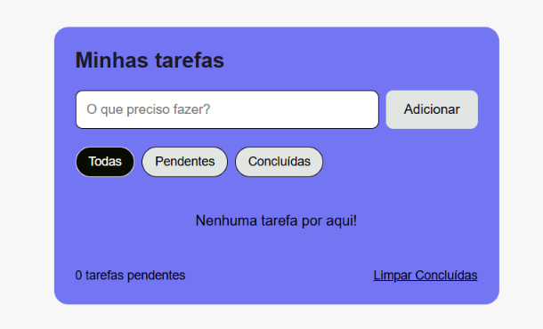

# Lista de Tarefas



Lista de tarefas feita com HTML, CSS e JavaScript, sem bibliotecas.

Foi meu segundo projeto, e o primeiro em que o HTML não estava todo pronto na página. Na calculadora os botões já existiam e eu só mexia neles. Aqui cada tarefa é criada pelo JavaScript na hora que eu adiciono, e isso mudou bastante a forma de pensar o código.

[Acessar lista de tarefas](link do GitHub Pages)

## Funcionalidades

- Adicionar tarefas
- Editar tarefas pendentes (confirma com Enter, cancela com Esc)
- Marcar e desmarcar como concluída
- Excluir tarefas
- Filtrar por todas, pendentes ou concluídas
- Limpar todas as concluídas de uma vez
- Contador de tarefas pendentes
- Tarefas salvas no navegador (continuam lá ao fechar a página)
- Layout responsivo

## Tecnologias

- HTML5
- CSS3
- JavaScript

## Como executar

```bash
git clone https://github.com/HellenMayara/lista-de-tarefas.git
```

Depois é só abrir o `index.html` no navegador.
Não é necessário instalar nada.

## Desafios enfrentados

**O botão adicionar não funcionava** → 
O botão de adicionar simplesmente não fazia nada. Fui conferir o código e tinha escrito `campoTarefa.ariaValueMax` no lugar de `campoTarefa.value`, porque aceitei sem querer uma sugestão do autocomplete do VS Code. Como essa propriedade não existe num campo de texto, a função quebrava antes de adicionar a tarefa. Depois descobri que o erro já estava aparecendo no console do navegador, e desde então passei a olhar lá sempre que algo não funciona.

**Tarefas com o mesmo nome se confundiam** →
Se eu criasse duas tarefas com o mesmo texto e marcasse a segunda tarefa, era a primeira que ficava marcada. O código procurava a tarefa pelo texto, então sempre encontrava a primeira com aquele nome. Cada tarefa já tinha um id único, que eu usava só na hora de excluir, então passei a guardar esse id no próprio elemento com `dataset` e a buscar por ele. Precisei usar `Number()` na comparação, porque o `dataset` devolve texto e o id era número.

**O campo de edição sumia na mesma hora em que era acionado** → 
Quando eu clicava em editar, nada acontecia. Na verdade acontecia, mas durava menos de um instante. Eu tinha deixado o `salvar()` e o `renderizar()` soltos no fim da função de clique, em vez de dentro de cada ramo, então eles rodavam sempre. O `renderizar()` redesenhava a lista inteira logo depois que o campo de edição era criado, apagando ele na mesma hora. Foi o erro que mais me confundiu, porque o sintoma parecia que "não funcionava" quando na verdade era "funciona e é desfeito na mesma hora".

## Melhorias futuras

- Campo de busca para encontrar tarefas pelo texto
- Categorias para organizar as tarefas
- Confirmação antes de excluir
- Salvar as tarefas em um banco de dados, para não ficarem presas a um navegador
- Login de usuário, para cada pessoa ter a própria lista

## Autoria

Feito por [Hellen Mayara](https://github.com/HellenMayara)